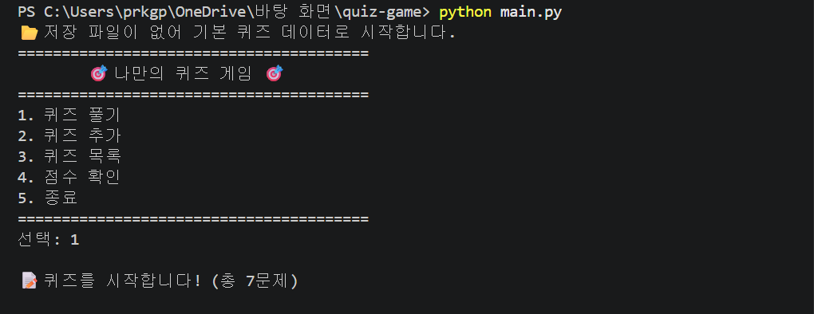
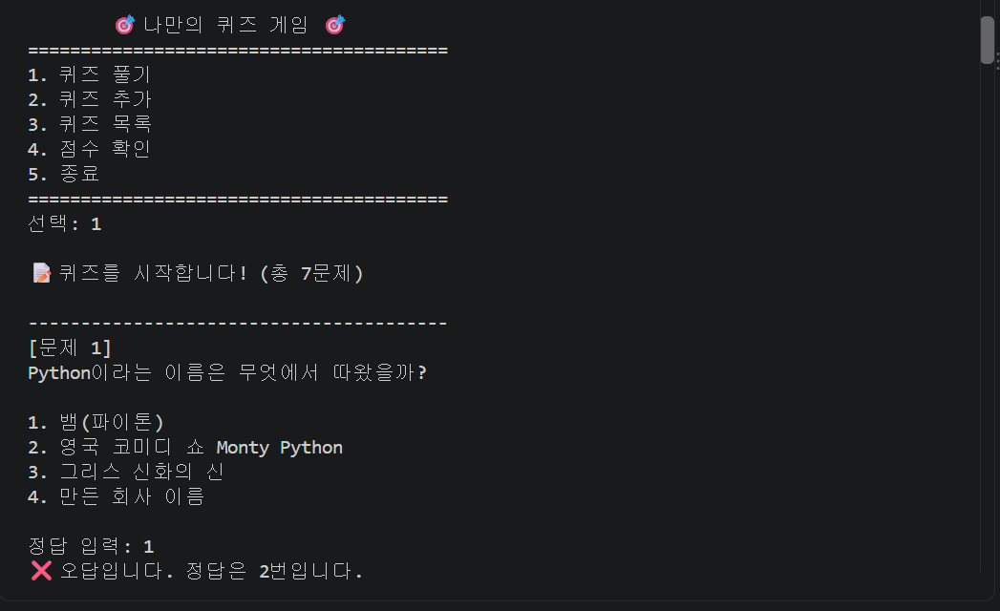
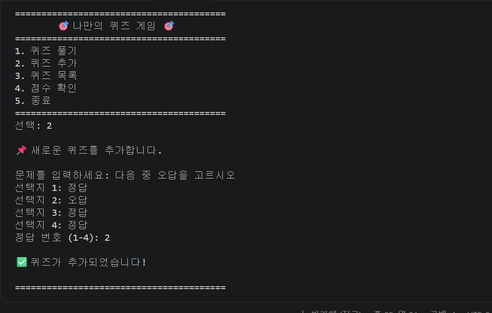
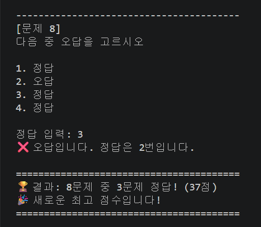

# 🐍 파이썬 상식 퀴즈 게임

## 프로젝트 개요
터미널에서 동작하는 파이썬 콘솔 퀴즈 게임입니다.
Python 기본 문법, 클래스(객체 지향), JSON 파일 입출력, Git/GitHub 사용법을 익히기 위해 처음부터 끝까지 직접 만들었습니다.
프로그램을 종료하고 다시 실행해도 추가한 퀴즈와 최고 점수가 유지됩니다.

## 퀴즈 주제와 선정 이유
- **주제:** 파이썬 관련 상식 (이름의 유래, 창시자, 문법 등)
- **선정 이유:** 이번 미션으로 파이썬을 처음 배우고 있어서, 파이썬 자체에 대한 상식을 퀴즈로 만들면 게임을 만드는 동시에 복습도 된다고 생각했습니다.

## 실행 방법
1. Python 3.10 이상 설치 (외부 라이브러리 불필요)
2. 저장소 내려받기
   ```bash
   git clone https://github.com/ranguem/quiz-game.git
   cd quiz-game
   ```
3. 실행
   ```bash
   python main.py
   ```

## 기능 목록
| 메뉴 | 설명 |
|---|---|
| 1. 퀴즈 풀기 | 저장된 퀴즈를 순서대로 출제하고 정답/오답 및 결과 점수를 보여줌 |
| 2. 퀴즈 추가 | 문제, 선택지 4개, 정답 번호를 입력해 새 퀴즈 등록 (자동 저장) |
| 3. 퀴즈 목록 | 등록된 퀴즈 목록 확인 |
| 4. 점수 확인 | 최고 점수 확인 (퀴즈를 풀 때마다 비교 후 갱신) |
| 5. 종료 | 프로그램 종료 (종료 시 자동 저장) |

**입력/예외 처리**
- 앞뒤 공백 제거, 빈 입력, 문자 입력, 범위 밖 숫자 → 안내 메시지 후 재입력
- Ctrl+C, 입력 스트림 종료(EOF) → 저장 후 안전하게 종료
- `state.json`이 없으면 기본 퀴즈로 시작, 손상되면 안내 후 기본 퀴즈로 초기화

## 파일 구조
```
quiz-game/
├── main.py              # 프로그램 시작점
├── quiz_game.py         # QuizGame 클래스 (메뉴, 게임 진행, 저장/불러오기)
├── quiz.py              # Quiz 클래스 (문제, 선택지, 정답)
├── default_quizzes.py   # 기본 퀴즈 데이터 7개
├── state.json           # 저장 데이터 (퀴즈 목록, 최고 점수)
├── .gitignore
├── README.md
└── docs/screenshots/    # 실행 화면 스크린샷
```

## 데이터 파일 설명 (state.json)
- **경로:** 프로젝트 루트의 `state.json` (UTF-8)
- **역할:** 프로그램을 종료해도 퀴즈와 최고 점수가 유지되도록 저장
- **스키마**

```json
{
    "quizzes": [
        {
            "question": "Python을 만든 사람은?",
            "choices": ["리누스 토발즈", "제임스 고슬링", "귀도 반 로썸", "비야네 스트롭스트룹"],
            "answer": 3
        }
    ],
    "best_score": {
        "score": 80,
        "correct": 4,
        "total": 5
    }
}
```

| 필드 | 설명 |
|---|---|
| `quizzes` | 퀴즈 목록 (문제 `question`, 선택지 4개 `choices`, 정답 번호 1~4 `answer`) |
| `best_score` | 최고 점수. 아직 풀지 않았다면 `null` |

## 실행 화면
| 메뉴 | 퀴즈 풀기 |
|---|---|
|  |  |

| 퀴즈 추가 | 점수 확인 |
|---|---|
|  |  |